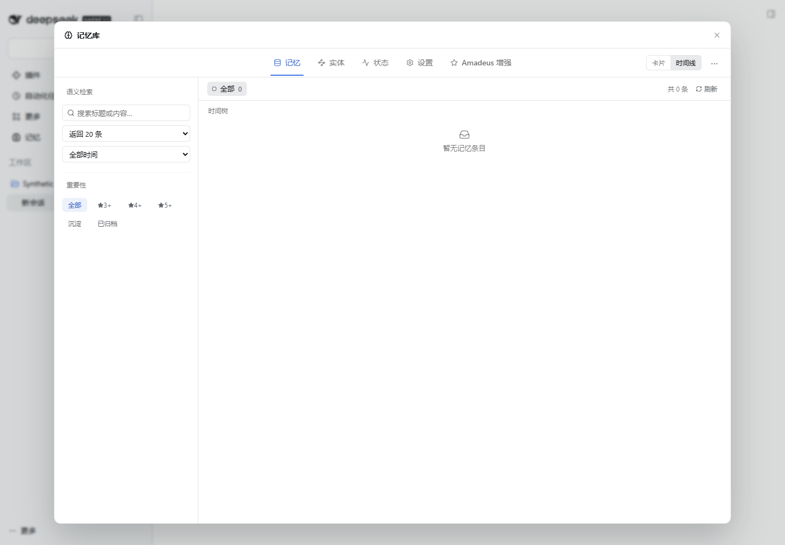

# Amadeus

Amadeus 以官方 DeepSeek Harness（DSH）为运行基础。五个独立插件分别负责人格、记忆、当前状态、自主活动和 QQ 交流，可分别安装、停用和升级。

**2026-10-31：五插件产品化资料已进入 main，正式发行仍待发布门禁和 npm 账户授权。** Memory 1.3.0，QQ/Life 1.2.1，State/Persona 1.2.0。中英文首页、预构建包、受保护发布流程和 Market 投稿材料已准备；尚未公开发布 npm 或 GitHub Release。见[本轮产品化与发行报告](AMADEUS_PRODUCT_RELEASE_2026-10-31.md)。

| 插件 | 当前 main 包版本 | 职责 |
| --- | --- | --- |
| [Memory](https://github.com/jeskoky-pixel/amadeus-memory) | @fg-lab/amadeus-memory@1.3.0 | 单 Workspace 记忆、Session ACL、Learn/Borrow、来源约束与全局图谱 |
| [QQ](https://github.com/jeskoky-pixel/amadeus-qq) | @fg-lab/amadeus-qq@1.2.1 | 连续聊天、可信 Session/Scene、平台权限与接管开关 |
| [Life](https://github.com/jeskoky-pixel/amadeus-life) | @fg-lab/amadeus-life@1.2.1 | 长期自主活动、意图、预算与唤醒 |
| [State](https://github.com/jeskoky-pixel/amadeus-state) | @fg-lab/amadeus-state@1.2.0 | Workspace 状态、精力、情绪和兴趣演化 |
| [Persona](https://github.com/jeskoky-pixel/amadeus-persona) | @fg-lab/amadeus-persona@1.2.0 | 一份核心人格与多个场景风格，独立 System Prompt Section |

历史主分支整合与备份见[整合报告](AMADEUS_MAIN_INTEGRATION_2026-10-31.md)。本轮补齐 QQ 四项 Linux 符号链接安全测试，并验证真实 NapCat 入站、受控私聊外发、可信新旧 Session 身份、Learn/Borrow 与撤权。独立/联合安装、外部数据卸载重装保留均有记录；模型自主活动和未完成项目仍按报告明确标注。

## 安装与数据

五仓库根目录均为插件包。Memory 已完成根目录整理，**不再使用 #path:/dsh-mneme**；其内部 ID 仍为 dsh-mneme，禁止同时加载旧 Mneme 与新 Memory 两个实例。

正式固定版本下载源将在发布门禁与账户授权完成后提供；当前本地预构建包供候选验收。不要将未发布 npm 版本或 main 当作正式发行地址。升级须保留 Profile、Workspace、用户数据目录与一致性备份；禁用不删除数据，卸载代码不等于清空数据。Memory 1.3.0 保留统一 ACL schema 2，不因包版本变化重置数据库。

人格不授予工具或 QQ 权限；Memory 不覆盖 Persona；QQ 负责当前聊天，Life 负责长期自主活动。其他插件均为可选协作，缺失时安全降级。

## 界面与历史

Memory 保留记忆、实体、状态、设置四页，加第五页 Amadeus 授权管理：

- [多仓库架构](docs/ARCHITECTURE.md)、[模块登记](modules/registry.yaml)、[版本记录](compatibility/versions.yaml)
- [升级与回滚说明](docs/V1_2_INSTALL_AND_UPGRADE.md)
- [v1.2 历史发行准备报告](AMADEUS_V1_2_RELEASE_READINESS.md)
- [五插件历史基线](docs/FIVE_PLUGIN_COMPATIBILITY.md)
- [v1.0 四插件历史证据](docs/verification/AMADEUS_V1_FOUR_PLUGIN_ACCEPTANCE.md)

历史报告保留原结论与局限，不用新版本号覆盖旧证据。Persona 在长历史中可能仍受旧风格上下文影响；最终系统提示词变化不等于保证模型立即完全改变表达。
