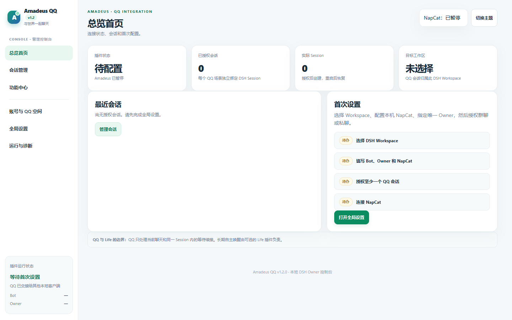
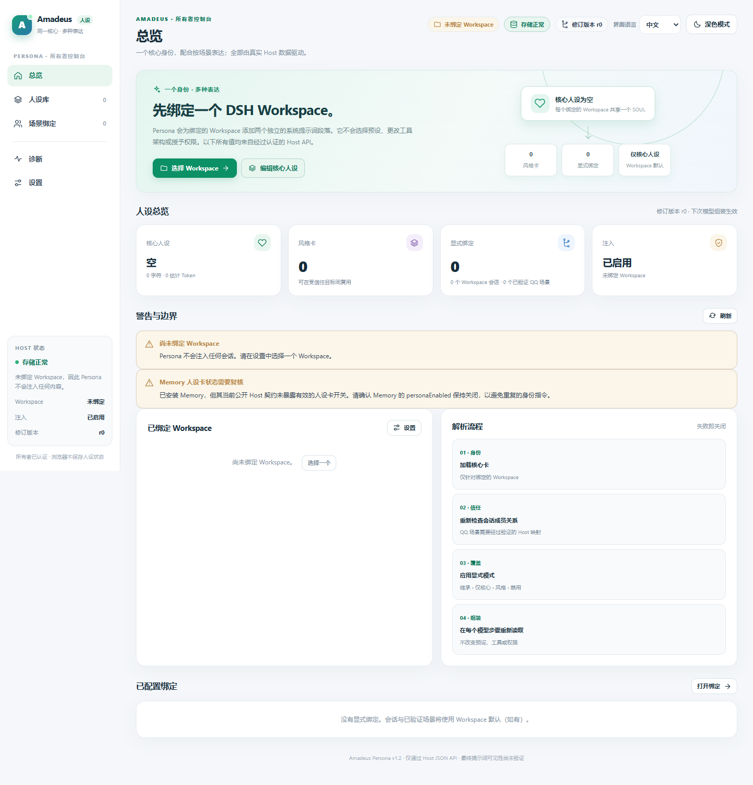

# Amadeus

Amadeus 以官方 DeepSeek Harness（DSH）作为同一智能主体的运行基础。五个独立插件分别负责人格、记忆、当前状态、自主活动和 QQ 交流；可独立安装、停用与升级，不通过切换 Agent Preset 制造不同的“她”。

**v1.2.0 正在进行正式发行验收。** 五个独立插件的目标 npm 包是 `@fg-lab/amadeus-{qq,memory,life,state,persona}@1.2.0`。Memory 正将完整插件工程迁至仓库根目录，内部插件 ID 仍为 `dsh-mneme`。在最终包通过测试、隔离安装和升级验收并完成公开发布前，请把各仓库 `main` 视作下表所示的旧开发基线。阅读 [v1.2 安装与升级](docs/V1_2_INSTALL_AND_UPGRADE.md)、[兼容矩阵](docs/V1_2_COMPATIBILITY.md)和[发行准备报告](AMADEUS_V1_2_RELEASE_READINESS.md)。

| 插件 | main 中的包版本 | 职责 |
| --- | --- | --- |
| [Amadeus Persona](https://github.com/jeskoky-pixel/amadeus-persona) | `@amadeus/persona@0.1.0` | 一份核心人格、可复用场景风格、选定 Workspace 内的可信 System Prompt 注入 |
| [Amadeus Memory](https://github.com/jeskoky-pixel/amadeus-memory) | `@amadeus/memory@1.0.1` | 长期记忆、近期活动、实体图谱与跨 Scene 安全召回 |
| [Amadeus State](https://github.com/jeskoky-pixel/amadeus-state) | `@amadeus/state@1.1.0` | 心情、精力、好奇心和兴趣的动态演化 |
| [Amadeus Life](https://github.com/jeskoky-pixel/amadeus-life) | `@amadeus/life@1.1.0` | 自主意图、活动调度、预算和唤醒 |
| [Amadeus QQ](https://github.com/jeskoky-pixel/amadeus-qq) | `@amadeus/qq@1.1.1` | QQ 连续交流、可信 Scene、NapCat 接口和平台权限 |

表内五个版本已合并到各自仓库的 `main`，构成 v1.1 阶段的个人电脑实机测试基线。v1.2 的对外包名将改为 `@fg-lab/amadeus-*`；旧包与新包不能同时安装，以免重复注册插件。五个插件可单独使用；其他插件缺席时，各自按文档降级。Persona 只决定“她是谁、在当前场景如何表达”，不替换 DSH Agent Preset，不增加模型工具，也不授予 QQ 或文件权限。

## v1.2 控制台预览

下图来自隔离 DSH Web Host 的真实浏览器，显示首次安装的空状态；尚未代表 Desktop 图形安装器或真实 QQ 接入验收。

| QQ 控制台 | Persona 控制台 |
| --- | --- |
|  |  |

QQ 1.1.1 在中文 Owner Web Console 加入“QQ 接管”开关，可暂停与恢复插件对 NapCat 的连接，供本地 AstrBot 与 DSH 轮流使用同一个 QQ 登录。补丁已通过自动化测试；真实 NapCat、AstrBot 与 DSH Desktop 的交接流程仍待个人电脑实测。

## 人格与场景

Persona 只绑定一个由管理员选择的 DSH Workspace。该 Workspace 的主 Session 和后续普通 Session 共用核心人格；群聊、私聊或指定 Session 可以选择不同的表达风格。QQ Scene 绑定以 QQ Host 提供的可信 Bot 与 Peer 身份为准；群里所有参与者使用该群 Scene 的风格。修改人格在下一模型步骤注入现有 Session，历史与工具保持，切换 Workspace 会备份并归档旧绑定。

Memory 负责她记得什么，State 负责她此刻的状态，Life 负责她想做什么及何时行动，QQ 负责交流渠道与执行期权限。人格文字本身不是权限边界；跨 Scene 记忆访问仍由 Memory 与 QQ 的可信契约检查。

## 安装与验证边界

目前核对的宿主是隔离 DSH Desktop `0.2.1-rc.3`。v1.2 将从每个仓库根目录打包；Memory 迁移完成后无需 `#path:/dsh-mneme`，其 Bundle ID 仍是 `dsh-mneme`。升级 Memory 前应备份数据并移除旧 `@amadeus/memory` 包，避免两个实例同时写入数据库。Persona 的管理界面选择 Workspace、编辑核心人格及场景风格；QQ、Memory、State、Life 各有独立设置和数据目录。

[五插件版本与验收边界](docs/FIVE_PLUGIN_COMPATIBILITY.md)记录了 main SHA、隔离 Desktop 同装、真实模型调用、离线 QQ Host 场景和仍未通过的实机项目。早期[四插件 v1.0 兼容矩阵](docs/FOUR_PLUGIN_COMPATIBILITY.md)与[原始联合验收](docs/verification/AMADEUS_V1_FOUR_PLUGIN_ACCEPTANCE.md)作为历史证据保留。

Persona 的长期测试会话在切回风格后曾复述旧风格，尽管最终 System Prompt 已更新；这是当前开发基线的**已知模型上下文局限**，详情见 [Persona 验收报告](https://github.com/jeskoky-pixel/amadeus-persona/blob/main/docs/VERIFICATION_2026-10-29.md)。上一轮五插件联测未连接真实 NapCat，也未完成 State 演化、Life 自主唤醒与长期生产负载测试。本轮将重新验证 `@fg-lab/*` 最终包；此前候选包的结果不能直接替代正式发行验收。市场条目仅准备材料，本轮不会向第三方市场投稿。

## 项目文档

- [多仓库架构与职责](docs/ARCHITECTURE.md)
- [插件登记表](modules/registry.yaml)与[版本清单](compatibility/versions.yaml)
- [五插件兼容与回滚要点](docs/FIVE_PLUGIN_COMPATIBILITY.md)
- [第一阶段四插件验收历史](docs/verification/AMADEUS_V1_FOUR_PLUGIN_ACCEPTANCE.md)

[Browser](https://github.com/jeskoky-pixel/amadeus-browser)、[Bilibili](https://github.com/jeskoky-pixel/amadeus-bilibili)、[Android](https://github.com/jeskoky-pixel/amadeus-android) 与 [Games](https://github.com/jeskoky-pixel/amadeus-games) 属于后续计划，不在这次五插件基线内。
